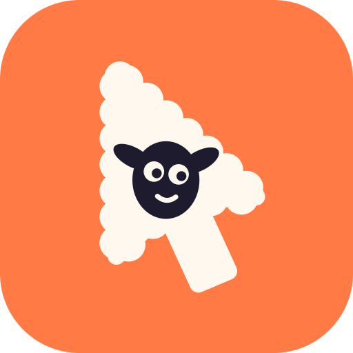

# dolly

Pointer, keyboard and accessibility input for screen recordings, plus eased
camera moves in post. Built for agents: one JSON object per call, stable exit
codes, and a `--guard` that refuses to touch the wrong app. macOS today; the
platform part is a small driver, so other systems are one driver away.

```console
$ dolly help | jq -r .text        # help is a JSON object too
$ dolly service start             # macOS grants Accessibility per process
$ dolly front
{"bundle":"com.example.App","command":"front","name":"App","ok":true,"pid":4711}

$ dolly hover 640,420 --guard 4711 --hold 1.4
{"command":"hover","held":1.4,"ms":703,"ok":true,"to":[{"x":640,"y":420}]}

$ dolly drag 300,64 900,540 --guard 4711 --ms 1200 --hold 0.8
$ dolly record 61527 /tmp/take 6 --loops 4
{"code":0,"command":"record","directory":"/tmp/take","fps":61.2,"frames":367,"ok":true,"seconds":6.0,…}
```

## Why

Synthetic input is the only way to film hover states and real drag sessions:
`onHover`, tooltips, drop overlays and SwiftUI/AppKit drag targets all need
pointer events that travel. `screencapture -l <windowID>` records one window
without stealing focus, so the same run can be cut into a film afterwards.

## Install

```console
$ ./scripts/install.sh              # needs swift and bun; builds Dolly.app in ~/Applications and signs it
$ ~/Applications/Dolly.app/Contents/MacOS/dolly service start
$ ~/Applications/Dolly.app/Contents/MacOS/dolly trust --prompt   # grant it, once
```

The installer signs with an Apple Development identity when one exists, so the
grant survives rebuilds. Ad-hoc signing works too, but macOS then asks again
after every rebuild — use `DOLLY_SIGN_IDENTITY` to pin an identity.

## Why a service

Accessibility belongs to a process. A driver started by a shell inherits the
shell's identity, and if the shell is not trusted its events are dropped
silently — `dolly trust` reports `false` and every verb refuses with exit 4.
`dolly service start` registers `dolly-driver` with launchd, which makes it
its own responsible process; every later call, from any shell, reaches it over
a UNIX socket. `dolly service status` shows it, `dolly service stop` ends it,
and `DOLLY_LOCAL=1` runs the driver directly instead. The service runs calls
side by side, so a `capture` in the background does not block input; input
still goes one call at a time.

## Commands

| command | what it does |
| --- | --- |
| `move <x,y>` | move the pointer |
| `path <x,y> <x,y> …` | one eased travel through several points |
| `hover <x,y>` | move, then hold so hover state settles |
| `click <x,y>` | move, press, release (`--button`, `--count`) |
| `drag <x,y> <x,y>` | press, travel while held, release — starts real drag sessions |
| `scroll <dy> [dx]` | wheel at the pointer |
| `key <code>` | virtual key code with `--modifiers cmd,shift,alt,ctrl` |
| `type <text>` | type into the focused control |
| `press <pid> <label>` | AX press by label, for menus and toolbar items |
| `find <pid> <label>` | list matching controls, to aim a press |
| `front` | frontmost app (pid, name, bundle) |
| `windows` | window ids and frames |
| `trust` | Accessibility state, `--prompt` to ask |
| `service start\|stop\|status` | the launchd-hosted driver service |
| `record <windowID> <dir> <seconds>` | window-only frames for a camera move |
| `capture <windowID> <out.mov> <seconds>` | one window as video, at the display's frame rate |
| `launch <app> [--isolated [dir]]` | start an app — with `--isolated`, a second copy with its own home — and wait for its window |
| `quit <pid>` | quit it again (`--force` if it hangs) |
| `snap <windowID\|--pid n> <out.png>` | one frame of a window to look at, with the `scale` back to screen points |
| `tree <pid>` | the window's controls: role, texts, actions, screen frame, `center` and shot-file `rect` |
| `events start <file>\|stop\|status` | log input and capture times during a take; `stop` returns them as beats |
| `camera …` | eased camera moves over a recording (below) |

Shared flags: `--guard <pid|bundle|name>` (refuse unless that app is frontmost),
`--ms`, `--ease inOut|out|inQuint|linear`.

Coordinates are global screen points, origin at the main display's top-left.
`dolly windows` gives a window's frame, so a shot can be written as offsets
inside a window and stay valid when the window moves.

Exit codes: `0` ok, `2` usage, `3` refused by guard, `4` Accessibility not
granted, `5` failed. Every call prints one JSON object with `ok` and `code`.

## Exploring an app

An agent that films an app it has never seen needs to try it first, without
touching the user's own data, and to look at what it did:

```console
$ dolly launch /Applications/Margin.app --isolated --size 1440,900 --at 80,60
{"ok":true,"pid":5120,"profile":"…/dolly/profiles/Margin-1792636000","ready":true,"window":{"id":88231,…}}
$ dolly snap --pid 5120 look.png          # PNG ≤1600 px, plus frame and scale
$ dolly tree 5120 | jq '.nodes[] | select(.role=="AXButton") | {title, center, rect}'
$ dolly quit 5120
```

`--isolated` starts a new instance with `HOME`, `TMPDIR` and the XDG
directories moved into a profile folder, so Application Support, caches and
dotfiles start empty. A sandboxed app keeps its container and `launch` says so
in `warning`. `tree`'s `rect` is the control's frame as a fraction of the
window — exactly what a shot file's `focus` takes — and `center` is the screen
point to click.

During a take, `events` notes when each input happened relative to the
recording, so a push-in can start on the frame the hover appears:

```console
$ dolly events start take/events.jsonl
$ dolly capture 88231 take/take.mov 8 &     # the service records and drives at once
$ dolly hover 620,410 --guard 5120 --hold 1.2
$ dolly events stop
{"ok":true,"beats":[{"verb":"hover","at":1.42,"until":2.31,"point":[0.3756,0.3881],…}],…}
```

## Camera moves

`dolly camera` crops a high-resolution recording along keyframes and eases
between them, so a push-in or pan is a number instead of a timeline. It needs
ffmpeg.

```console
$ dolly camera --input take.mp4 --out push-in.mp4 \
    --keys 0:1.0:0.5:0.5 0.4:1.0:0.5:0.5 2.6:1.28:0.16:0.34 --strip strip.jpg
{"ok":true,"source":[2560,1600],"ceiling":1.481,"zoom":[1.0,1.0,1.28],"clamped":false,...}
```

`t:zoom:x:y[:ease]` — `zoom` is the magnification, `x`/`y` the normalised point
of the window kept at the centre. The camera follows a monotone spline through
the keyframes (zoom eases by ratio, so a push-in looks even), and a move through several
keyframes never stalls on the middle ones. The window is first padded
(`--fit pad`, default) or cropped (`--fit crop`) to the output aspect
(`--aspect 16:9`, `9:16`, `1:1`, `4:5`); beyond `ceiling` (that canvas's width
÷ output width) the image would be upscaled, so zooms are clamped there and
reported. `--strip` writes a five frame contact strip of the result.

Named moves save the arithmetic. A shot file lists beats — `focus` on a
control's rect, `pan-to`, `punch-in`, `drift`, `tour`, `pull-back` — and
`--explain` prints the keyframes they expand to, with warnings for moves that
start too early, run too fast or hit the ceiling:

```console
$ dolly camera --shot shot.json --explain
{"ok":true,"keys":["0.000:1.000:0.500:0.500:spline",...],"peak_pan":0.21,"warnings":[]}
$ dolly camera --shot shot.json --strip strip.jpg
```

See [`skills/dolly/SKILL.md`](skills/dolly/SKILL.md) for the shot vocabulary
and the recording workflow.

## How it is built

```
packages/core       everything dolly computes, no IO: eases, camera spline, named moves,
                    --explain review, the ffmpeg graph, pointer travel and gestures
                    as input timelines, window picking, take-log beats
packages/protocol   the driver ops and their JSON types: the only platform boundary
packages/cli        the `dolly` command, one file per verb group in src/verbs/, and
                    `@dolly/cli/client` to call the same verbs from TypeScript
drivers/macos       dolly-driver (Swift): plays input timelines, reads AX, lists and
                    captures windows, launches apps, and hosts the launchd service
apps/studio         the desktop app (Tauri + TypeScript)
site/               the onboarding page; site/js/camera.js is built from the core
```

A verb parses argv into typed params, plans with the core and calls driver ops
(`input`, `windows`, `tree`, `video`, `launch`…). A driver only does what needs
the platform, and plays an input timeline exactly as planned, so a hover, a
click or a drag moves the same way everywhere. Porting dolly is writing one
driver for the 17 ops in `packages/protocol/src/index.ts`.

```console
$ bun install
$ bun test                       # core, golden plans, every verb on a fake driver, ffmpeg renders
$ bun run typecheck
$ bun packages/cli/src/main.ts camera --shot shot.json --explain
$ swift build --package-path drivers/macos      # on a Mac
```

`packages/core/test/fixtures/golden.json` was recorded from the Python
`camera.py` this replaced; the core reproduces its keyframes, warnings and
filter graph exactly. Every verb is tested against `FakeDriver`
(`@dolly/cli/fake`), a scripted screen that records the ops it receives.

## Extending

A new verb is `verb({ name, summary, usage, parse, run })` in
`packages/cli/src/verbs/` and one line in `registry.ts`. Plan motion in the
core and send it as one `input` timeline; check `requireTrust` and
`guardFront` before anything that clicks or types. A new op is needed only for
something the platform alone can do: add it to `packages/protocol` and to each
driver's `Ops.swift` (or equivalent).

## Icon

`assets/` holds the mark: `icon.svg` (full bleed), `icon-dark.svg`,
`icon-small.svg` (simplified for 32 px and below) and `AppIcon.svg` on the
macOS 1024/824 grid, which `AppIcon.icns` is rendered from.

## Site

`site/` is a static onboarding page with no dependencies. Open
`site/index.html`, or serve it with `python3 -m http.server -d site`. Its
animations are canvas, driven by `site/js/camera.js`, which `bun run
build:site` bundles from `@dolly/core`, so the moves it shows are the moves
`dolly camera` renders; a test fails when the bundle is stale.

## Licence

MIT.
